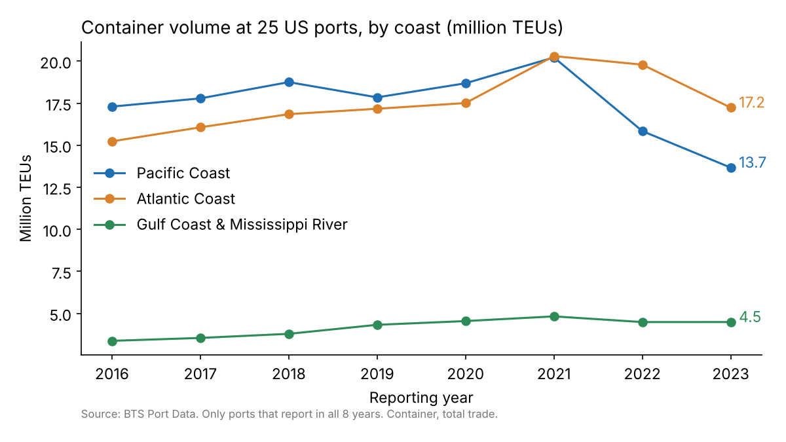
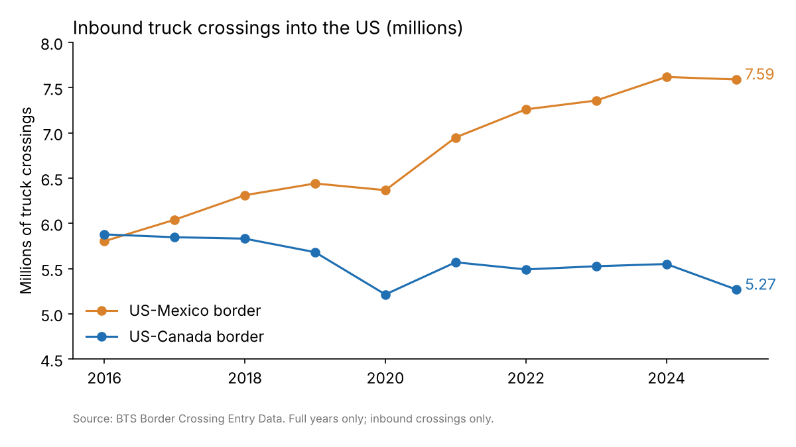
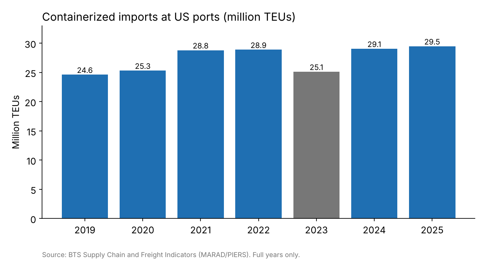
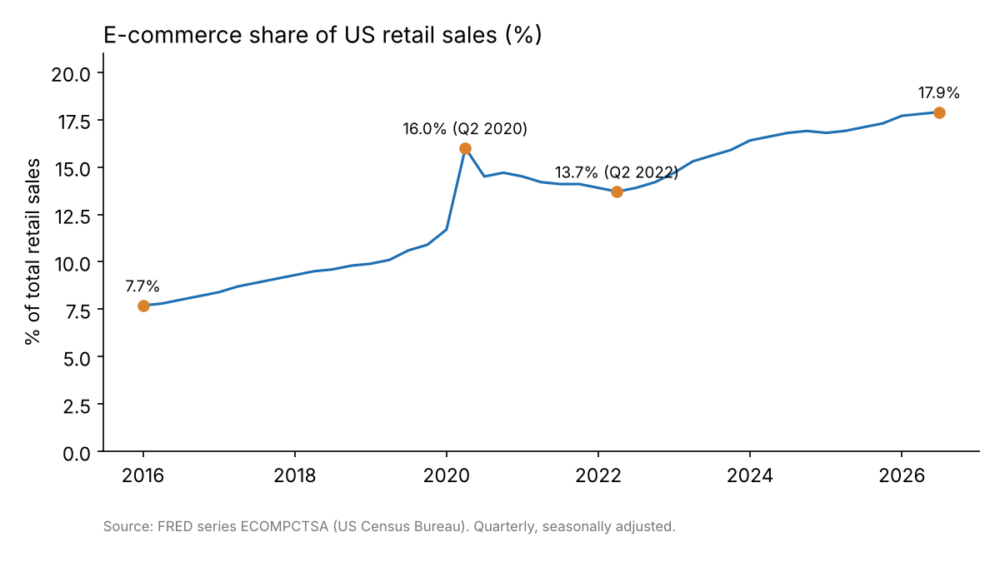
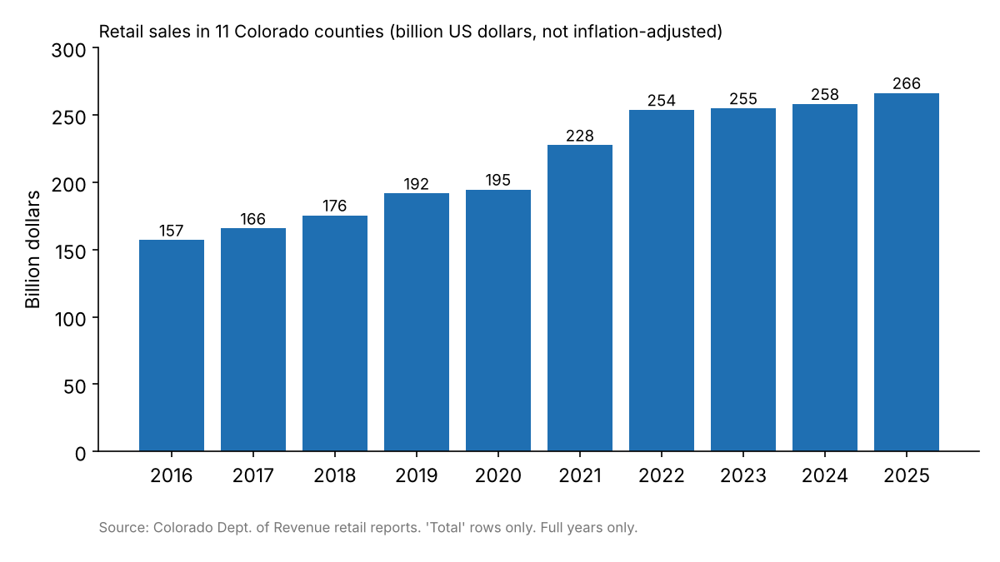

# Is the US goods supply chain keeping up with what consumers buy?

This repo holds my GMBA 634 term project: five real public datasets, one chart and one claim for each, on one common question.

Site: [my live site](https://sonysimonbusiness-maker.github.io/gmba634-term-project/)

## The project package
1. **Written executive case** (situation, complication, resolution): [case/executive-case.md](case/executive-case.md)
2. **AI use and output check**, with a script that recomputes every headline figure: [ai-check/](ai-check/)
3. **Tableau charts:** in progress, to be linked here.
4. **This repo and the live site** above link all of it.

AI use is disclosed in each folder and on the site. Claude drafted the case, charts and site; I own the question, audience and recommendation.

## Supply side: where goods move
| # | Claim | Chart |
|---|-------|-------|
| 1 | [Container volume at West Coast ports fell 32% from 2021 to 2023, more than the Atlantic (15%) or Gulf (7%).](datasets/01-ports/) |  |
| 2 | [Truck crossings from Mexico rose 31% from 2016 to 2025 while Canada fell 10%.](datasets/02-border-crossings/) |  |
| 3 | [Container imports fell 13% in 2023 and were back above their 2022 level by 2025.](datasets/03-container-imports/) |  |

## Demand side: what consumers buy
| # | Claim | Chart |
|---|-------|-------|
| 4 | [E-commerce share of retail rose from 7.7% in 2016 to 17.9% in 2026 and did not return to its 2019 level.](datasets/04-ecommerce-share/) |  |
| 5 | [Retail sales in 11 Colorado counties grew 70% from 2016 to 2025, but growth has slowed since 2022.](datasets/05-colorado-retail/) |  |

## What the five together say
Freight volume has moved: away from West Coast ports and toward Gulf and Atlantic ports, and toward the Mexico border. Consumer demand keeps shifting toward online buying while overall retail growth slows. These datasets cannot measure whether capacity is keeping up with demand. Each one shows only one side, so each folder states what its data cannot say.

## What each folder holds
Each `datasets/` folder has a claim, six story boxes (ask, situation, complication, question, resolution, reversal), a chart, the yearly data where the terms allow, and a data note with its source, licence and limits.

## AI use
I used Claude (an AI assistant) to pull the data through public APIs, compute the numbers, draw the charts and draft the claims and boxes. I review, correct and own the final text. All data is public; nothing here is confidential. The `archive/` folder holds my earlier work on a course case, which used course-made illustrative data and is not part of this portfolio.
