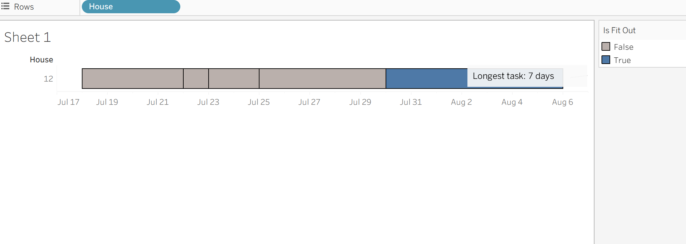

# Executive case: Fit Out and the handover date

DRAFT. Built only from my story boxes in `scr-worksheet.md`. Parts marked [ADD] are for me to write in my own words.

## Situation
All 50 houses follow the same plan: five tasks, about 19 days, ending with Fit Out. The data is the course house-schedule case. It holds planned dates only.

[ADD: 2 or 3 sentences on who Diane Torres is and what she is responsible for, in my words.]

## Complication
Fit Out is the longest task at 7 days, and it comes last. If any earlier task runs late, the handover date moves. The chart below shows House 12; every house follows the same plan.

These are planned numbers, not measured ones. The data cannot show how often tasks actually slip.

[ADD: what I see in the chart that supports this, in my words.]

## Resolution
I am asking Diane Torres to approve funding for more people on Fit Out at Friday's vote.

- Owner: Diane Torres.
- Cost: UNKNOWN. The table shows 130 for Fit Out, but I have not confirmed the units.
- Rejected option: do nothing and keep the plan as it is.

[ADD: why more people on Fit Out helps, in my words. Do not add numbers I have not checked.]

## What would change my recommendation
I would reverse this if the plan showed [UNKNOWN number] days of slack between Build interior and Fit Out. I would look in the Gantt chart and the Rollup. If it did, I would withdraw the ask.

## Limits
- The 19-day length comes from House 12 only.
- The units of the Fit Out cost are not confirmed.
- Planned dates only, so no slips are recorded.

## AI use
The decision, the answers and the chart are mine. Claude (an AI assistant) set up this outline from my story boxes. I write and check the rest.
