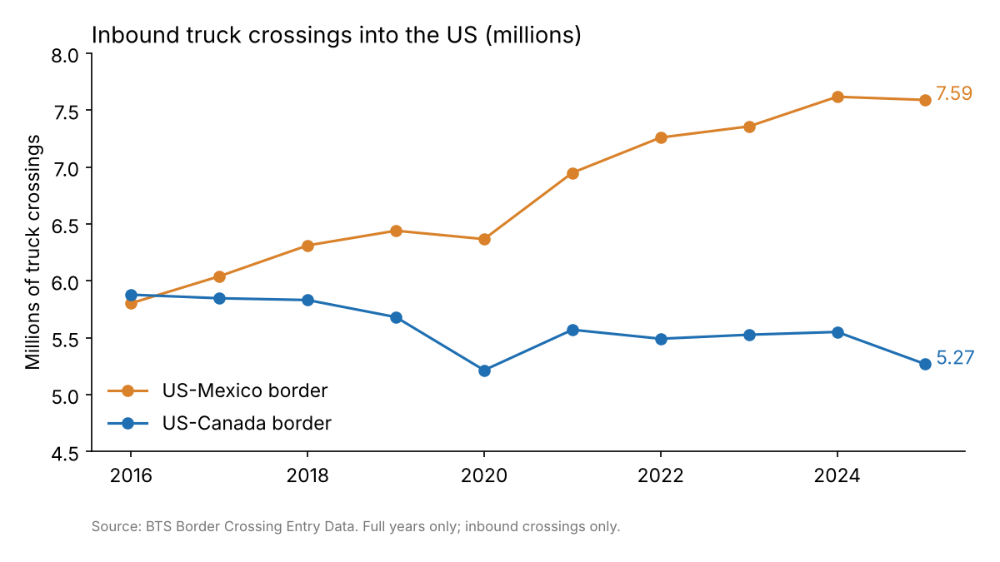
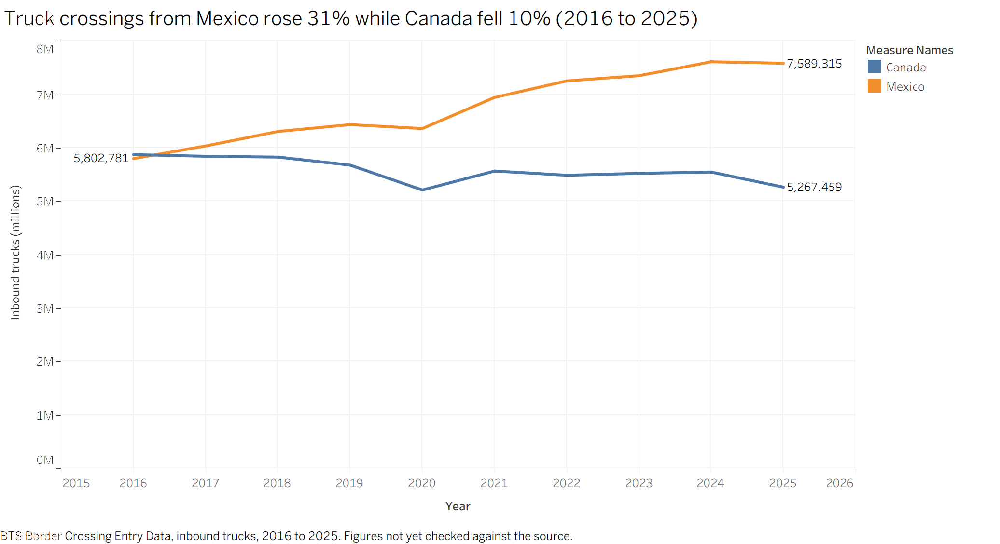

# 2. Border crossings: truck traffic shifted toward Mexico

**Claim.** Inbound truck crossings from Mexico rose 31% from 2016 to 2025 (5.8 million to 7.6 million), while crossings from Canada fell 10% (5.9 million to 5.3 million).

## Story boxes (DRAFT, to be reviewed in my own words)
1. **Ask.** I am asking a freight company's capacity planner to give US-Mexico lanes more trucking capacity than US-Canada lanes in the next planning round.
2. **Situation.** In 2016 the two borders carried about the same inbound truck traffic: 5.9 million crossings from Canada and 5.8 million from Mexico.
3. **Complication.** By 2025 Mexico was at 7.6 million (up 31%) and Canada at 5.3 million (down 10%). Mexico passed Canada in 2017 and the gap has widened almost every year since.
4. **Question.** So should we plan more trucking capacity on US-Mexico lanes than on US-Canada lanes?
5. **Resolution.** Shift planning toward US-Mexico lanes. Owner: the capacity planner. Date: UNKNOWN. Cost: UNKNOWN. Rejected option: keep the split as it is.
6. **Reversal.** I would reverse this if the next full year showed Mexico crossings below their 2019 level of 6.4 million, or Canada back at its 2016 level of 5.9 million. I would look in the same BTS border data.

## Data note
Source: US DOT Bureau of Transportation Statistics, Border Crossing Entry Data (https://data.bts.gov/d/keg4-3bc2). Public Domain. Measure: Trucks, summed by year and border. 2026 is a partial year and is left out. `data.csv` holds the yearly totals.

## Limits
- Inbound crossings only. It says nothing about outbound traffic, wait times or the value of goods.
- Counts are crossings, not companies or unique trucks.

## AI use
Claude (an AI assistant) pulled the data through the public API, computed the numbers, drew this chart, and drafted the claim and boxes from them. I review, correct and own the final text. Nothing here is confidential: all data is public.

## Tableau version

Built in Tableau from [data.csv](data.csv). The figures are not yet checked against the original BTS source (see [../../ai-check/](../../ai-check/)).
