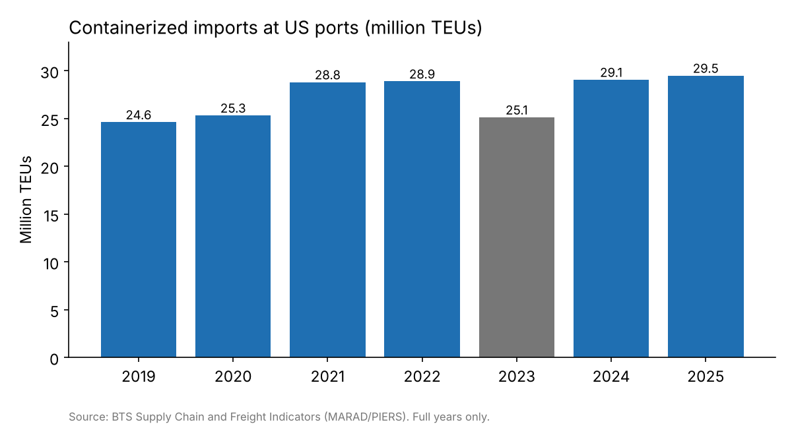

# 3. Container imports: a 2023 dip that recovered

**Claim.** US container imports fell 13% in 2023 (28.9 million to 25.1 million TEUs) and were back to 29.5 million by 2025.

## Story boxes (DRAFT, to be reviewed in my own words)
1. **Ask.** I am asking a freight company's capacity planner to treat the 2023 drop in container imports as temporary and not cut import-related capacity.
2. **Situation.** Container imports at US ports grew from 24.6 million TEUs in 2019 to 28.9 million in 2022.
3. **Complication.** In 2023 imports fell 13% to 25.1 million. In 2024 they were back at 29.1 million, and in 2025 at 29.5 million, above the 2022 level.
4. **Question.** So should we keep import-related capacity at its recent level?
5. **Resolution.** Keep capacity and do not plan around the 2023 dip. Owner: the capacity planner. Date: UNKNOWN. Cost: UNKNOWN. Rejected option: cut capacity to match 2023.
6. **Reversal.** I would reverse this if a full year of imports fell below 2023's 25.1 million TEUs again. I would look in the same BTS indicator table.

## Data note
Source: US DOT Bureau of Transportation Statistics, Supply Chain and Freight Indicators (https://data.bts.gov/d/y5ut-ibwt), indicator "Containerized Imports at U.S. Ports in TEUs" (series from MARAD, using IHS Markit PIERS data). Public Domain U.S. Government. Monthly values are summed by year. Only full years are shown; 2026 has 10 months so far (25.3 million TEUs). `data.csv` holds the yearly totals.

## Limits
- National totals built by one source. They cannot show one firm's volume or delays.
- It shows what happened, not why.

## AI use
Claude (an AI assistant) pulled the data through the public API, computed the numbers, drew this chart, and drafted the claim and boxes from them. I review, correct and own the final text. Nothing here is confidential: all data is public.
