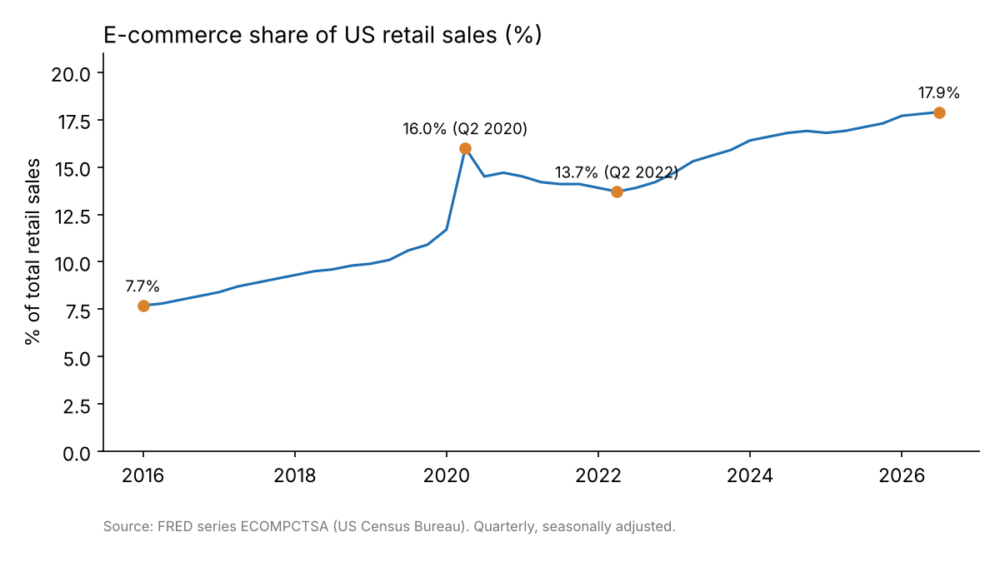

# 4. E-commerce share of retail: higher after every shock

**Claim.** E-commerce's share of US retail sales rose from 7.7% in early 2016 to 16.0% in Q2 2020, eased to 13.7% by Q2 2022, and reached 17.9% in 2026, more than double the 2016 share.

## Story boxes (DRAFT, to be reviewed in my own words)
1. **Ask.** I am asking a freight company's capacity planner to plan for a rising share of parcel and home-delivery volume rather than a return to 2019 patterns.
2. **Situation.** E-commerce was 9.9% of US retail sales in early 2019.
3. **Complication.** The share jumped to 16.0% in Q2 2020, eased to 13.7% by Q2 2022, and then rose again to 17.9%. It did not return to its 2019 level.
4. **Question.** So should we plan for e-commerce to keep growing as a share of retail?
5. **Resolution.** Plan for rising delivery-related demand. Owner: the capacity planner. Date: UNKNOWN. Cost: UNKNOWN. Rejected option: assume a return to 2019 patterns.
6. **Reversal.** I would reverse this if the share fell back below its 2022 low of 13.7% for two quarters in a row. I would look in the same FRED series.

## Data note
Source: Federal Reserve Bank of St. Louis (FRED), series ECOMPCTSA from the US Census Bureau (https://fred.stlouisfed.org/series/ECOMPCTSA). Quarterly, seasonally adjusted. **Link only:** FRED terms ask for attribution and some series are copyrighted, so the data file is not committed here. Only the chart is.

## Limits
- National share only, with no category or region detail.
- Quarterly data gives about 43 points since 2016. A rising share does not by itself show delivery volume.

## AI use
Claude (an AI assistant) pulled the data through the public API, computed the numbers, drew this chart, and drafted the claim and boxes from them. I review, correct and own the final text. Nothing here is confidential: all data is public.
