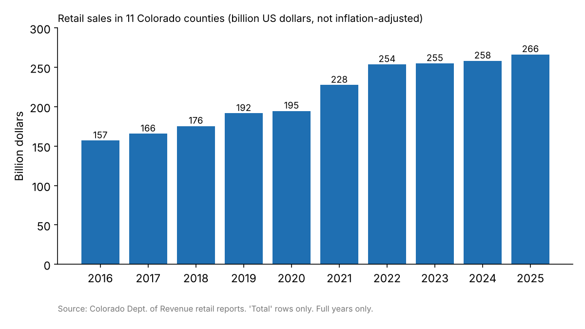

# 5. Colorado retail: strong growth, now slowing

**Claim.** Retail sales in 11 Colorado counties grew 70% from 2016 to 2025 ($157 billion to $266 billion), but growth slowed to 0.5%, 1.3% and 3.2% in 2023, 2024 and 2025 after an 11.5% jump in 2022.

## Story boxes (DRAFT, to be reviewed in my own words)
1. **Ask.** I am asking a freight company's capacity planner serving Colorado to plan for slow, steady retail growth and not another surge.
2. **Situation.** Retail sales in these 11 counties grew every year from 2016 to 2025, from $157 billion to $266 billion.
3. **Complication.** Growth was 11.5% in 2022, then only 0.5% in 2023, 1.3% in 2024 and 3.2% in 2025. These are dollars, not adjusted for inflation.
4. **Question.** So should we plan Colorado retail freight for slow growth?
5. **Resolution.** Plan for modest growth. Owner: the capacity planner. Date: UNKNOWN. Cost: UNKNOWN. Rejected option: plan for a repeat of the 2021 to 2022 surge.
6. **Reversal.** I would reverse this if 2026 full-year sales grew more than 10% over 2025. I would look in the same Colorado Department of Revenue data.

## Data note
Source: Colorado Department of Revenue via data.colorado.gov, Retail Reports by Industry and County (https://data.colorado.gov/api/views/fe4v-h3pk). Public Domain, attribution CDOR. Only the 'Total' industry rows are used, so nothing is double counted. 2026 is partial and left out. `data.csv` holds the yearly totals.

## Limits
- Covers only 11 counties (Adams, Arapahoe, Boulder, Denver, Douglas, El Paso, Jefferson, Larimer, Mesa, Pueblo, Weld), not all of Colorado.
- Sales-tax-return figures by filing month, in current dollars.

## AI use
Claude (an AI assistant) pulled the data through the public API, computed the numbers, drew this chart, and drafted the claim and boxes from them. I review, correct and own the final text. Nothing here is confidential: all data is public.
