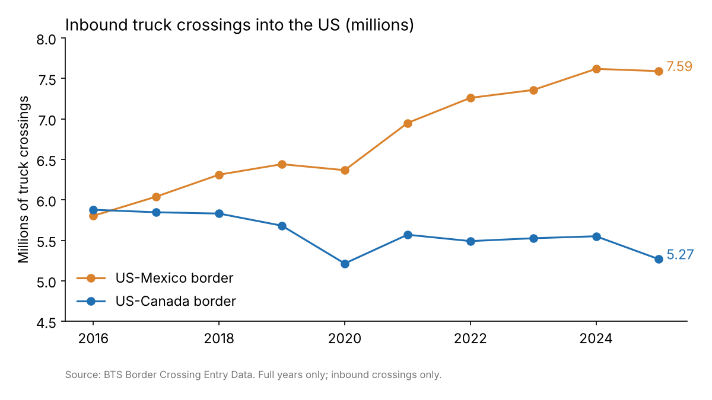

# Should we plan more trucking capacity on US-Mexico lanes than on US-Canada lanes?

## Who decides what
A freight broker's capacity planner decides whether to give US-Mexico lanes more trucking capacity than US-Canada lanes in the next planning round.

## Data
- Publisher: US Department of Transportation, Bureau of Transportation Statistics (BTS)
- Link: https://data.bts.gov/d/keg4-3bc2
- Date accessed: 2026-11-19 (pulled through the publisher's data interface; queried again 2026-11-21)
- License or terms: Public domain (US government data)
- Repo rule: LINK ONLY

## What one row means
One row is one border crossing point, one month and one kind of crossing measure. I kept the measure Trucks.

## What I did in my tool (Excel or Tableau)
- Tool: Python (pandas), run by Claude. I used Tableau for the border chart.
- Columns I kept: border, date, measure, value
- Filters: measure is Trucks; years 2016 to 2025 only (2026 is a partial year)
- Pivot: rows border, columns year, values sum of value (trucks). Millions and percent change are their own columns.
- Rows after my filters: Canada 9,185 rows and Mexico 2,549 rows (counted at the source).
- Check pivot: I expected 120 months per border (10 years times 12 months) and found 120 for each border, counted at the source.
- Pivot file: analysis/border-trucks-pivot.csv (https://github.com/sonysimonbusiness-maker/gmba634-term-project/blob/main/analysis/border-trucks-pivot.csv)

## What the numbers show
```
border,trucks_2016,trucks_2017,trucks_2018,trucks_2019,trucks_2020,trucks_2021,trucks_2022,trucks_2023,trucks_2024,trucks_2025,millions_2016,millions_2025,change_2016_to_2025_pct
Mexico,5802781,6039774,6310903,6440255,6366384,6949300,7259106,7356659,7617207,7589315,5.80,7.59,30.8
Canada,5877938,5846597,5830926,5681158,5214333,5569786,5490878,5526062,5550630,5267459,5.88,5.27,-10.4
```


[Tableau version of the chart](https://raw.githubusercontent.com/sonysimonbusiness-maker/gmba634-term-project/main/images/border-trucks-tableau.png)

## My finding
From 2016 to 2025, inbound truck crossings from Mexico rose 30.8%, from 5.80 million to 7.59 million, while crossings from Canada fell 10.4%, from 5.88 million to 5.27 million.

## What this data cannot show
It counts inbound crossings only, not outbound traffic, wait times or the value of goods, so it cannot show which lanes earn more.

## What I checked
I built a Tableau line chart from this data and its line-end labels matched the pivot (Mexico 5,802,781 and 7,589,315; Canada 5,267,459). Claude recomputed the percents with a script and re-queried the source on 2026-11-21: the border totals matched exactly.

## Number trail
See analysis/number-trail.md (https://github.com/sonysimonbusiness-maker/gmba634-term-project/blob/main/analysis/number-trail.md)
