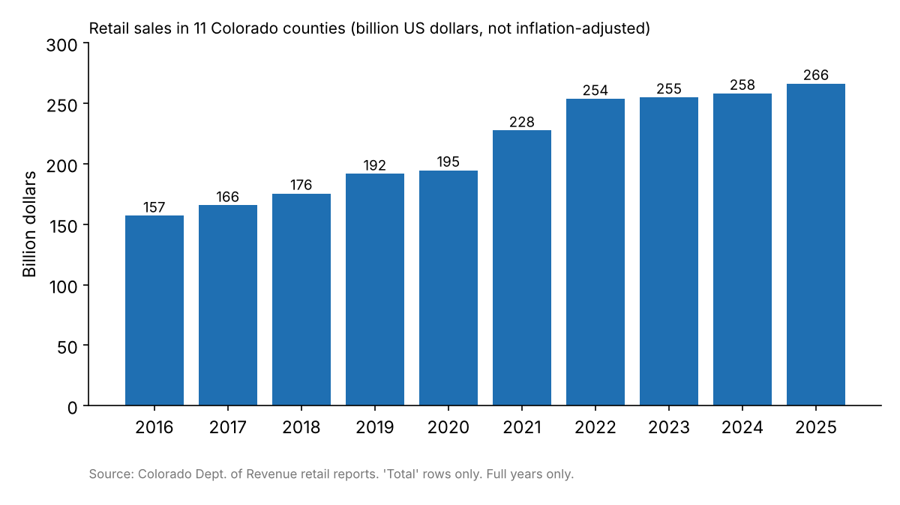

# Should a retail distribution manager plan for slower sales growth in these 11 Colorado counties?

## Who decides what
A retailer's regional distribution manager decides how much truck capacity to plan for stores in these 11 Colorado counties.

## Data
- Publisher: Colorado Department of Revenue, through data.colorado.gov
- Link: https://data.colorado.gov/api/views/fe4v-h3pk
- Date accessed: 2026-11-19 (pulled through the publisher's data interface)
- License or terms: Public domain; attribution to the Colorado Department of Revenue
- Repo rule: LINK ONLY

## What one row means
One row is one county, one month and one industry group. I kept the industry group Total.

## What I did in my tool (Excel or Tableau)
- Tool: Python (pandas), run by Claude. I used Tableau for the border chart.
- Columns I kept: year, month, county, industry, retailsales
- Filters: industry is Total; 11 counties (Adams, Arapahoe, Boulder, Denver, Douglas, El Paso, Jefferson, Larimer, Mesa, Pueblo, Weld); years 2016 to 2025 (2026 is partial)
- Pivot: rows year, values sum of retail sales in dollars. Billions and percent change are their own columns.
- Rows after my filters: UNKNOWN. I pulled yearly sums through the publisher's data interface and did not download the file.
- Check pivot: I expected 1,320 county-months (11 counties times 12 months times 10 years). The source returns more Total rows than that (4,224 per year for 2016 to 2021), and I have not yet explained why, so this check is still open.
- Pivot file: analysis/colorado-retail-pivot.csv (https://github.com/sonysimonbusiness-maker/gmba634-term-project/blob/main/analysis/colorado-retail-pivot.csv)

## What the numbers show
```
year,retail_sales_usd,retail_sales_billions,change_vs_2016_pct
2016,157048180000,157.05,0.0
2017,165708282000,165.71,5.5
2018,175564742000,175.56,11.8
2019,191718008000,191.72,22.1
2020,194745692000,194.75,24.0
2021,227596857501,227.6,44.9
2022,253814818725,253.81,61.6
2023,255068872101,255.07,62.4
2024,258304077267,258.3,64.5
2025,266466023961,266.47,69.7
```


## My finding
Retail sales in 11 Colorado counties rose 69.7% from 2016 to 2025, from $157.05 billion to $266.47 billion.

## What this data cannot show
It covers 11 counties in current dollars, so part of the growth is price change and it says nothing about the rest of Colorado.

## What I checked
Claude recomputed the percent change from the pivot values with a script and it matched. I have not yet compared the pivot with the source or explained the row count above.

## Number trail
See analysis/number-trail.md (https://github.com/sonysimonbusiness-maker/gmba634-term-project/blob/main/analysis/number-trail.md)
