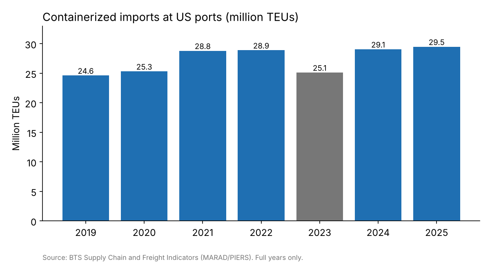

# Should a port logistics planner plan for another import dip like the one in 2023?

## Who decides what
A port-area logistics planner decides how much warehouse and trucking capacity to line up near US container ports next year.

## Data
- Publisher: US Department of Transportation, Bureau of Transportation Statistics (BTS), series from the Maritime Administration
- Link: https://data.bts.gov/d/y5ut-ibwt
- Date accessed: 2026-11-19 (pulled through the publisher's data interface; queried again 2026-11-21)
- License or terms: Public domain (US government data)
- Repo rule: LINK ONLY

## What one row means
One row is one month of containerized imports at US ports, in TEUs (twenty-foot equivalent units, a standard container size).

## What I did in my tool (Excel or Tableau)
- Tool: Python (pandas), run by Claude. I used Tableau for the border chart.
- Columns I kept: date, indicator, value1
- Filters: indicator is Containerized Imports at U.S. Ports in TEUs; full years 2019 to 2025 only (2026 is a partial year)
- Pivot: rows year, values sum of monthly TEUs. Millions and percent change are their own columns.
- Rows after my filters: UNKNOWN. I pulled yearly sums through the publisher's data interface and did not download the monthly file.
- Check pivot: I expected 84 monthly values (7 years times 12 months). I could not confirm that count at the source, so this check is still open.
- Pivot file: analysis/container-imports-pivot.csv (https://github.com/sonysimonbusiness-maker/gmba634-term-project/blob/main/analysis/container-imports-pivot.csv)

## What the numbers show
```
year,teu,teu_millions,change_vs_prior_year_pct
2019,24624203.35,24.62,
2020,25324066.04,25.32,2.8
2021,28809941.0,28.81,13.8
2022,28891318.72,28.89,0.3
2023,25127862.47,25.13,-13.0
2024,29064394.5,29.06,15.7
2025,29490989.0,29.49,1.5
```


## My finding
US container imports fell 13.0% from 2022 to 2023, from 28.89 million to 25.13 million TEUs.

## What this data cannot show
It adds up all US ports for each year, so it cannot show which ports or coasts lost volume in 2023.

## What I checked
Claude recomputed the percent change from the pivot values with a script and it matched. Claude re-queried the source on 2026-11-21 and the 2022 and 2023 totals matched exactly. I have not yet compared the pivot with the BTS site myself.

## Number trail
See analysis/number-trail.md (https://github.com/sonysimonbusiness-maker/gmba634-term-project/blob/main/analysis/number-trail.md)
