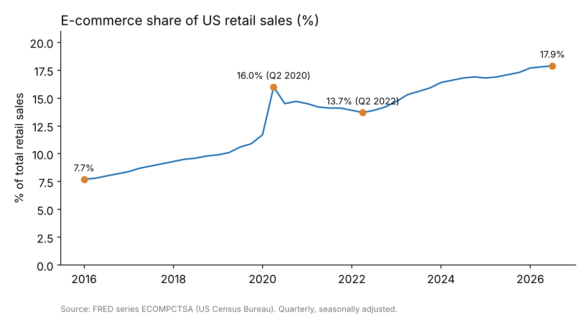

# Should we plan for e-commerce to keep a higher share of retail sales?

## Who decides what
A parcel and delivery capacity planner decides how much home-delivery capacity to line up for next year.

## Data
- Publisher: Federal Reserve Bank of St. Louis (FRED), series ECOMPCTSA from the US Census Bureau
- Link: https://fred.stlouisfed.org/series/ECOMPCTSA
- Date accessed: 2026-11-19 (read through the FRED download link; queried again 2026-11-21)
- License or terms: Attribution required; some FRED series are copyrighted (see the series page)
- Repo rule: LINK ONLY

## What one row means
One row is one quarter: e-commerce as a percent of total US retail sales, seasonally adjusted.

## What I did in my tool (Excel or Tableau)
- Tool: Python (pandas), run by Claude. I used Tableau for the border chart.
- Columns I kept: observation date, value
- Filters: quarters from 2016 Q1 to 2026 Q3 (43 values); the pivot keeps four of them
- Pivot: rows quarter, values percent of retail sales. The change in percentage points is its own column.
- Rows after my filters: 43 quarterly values. I did not save a data file.
- Check pivot: I expected 43 quarterly values (2016 Q1 to 2026 Q3) and found 43.
- Pivot file: analysis/ecommerce-share-pivot.csv (https://github.com/sonysimonbusiness-maker/gmba634-term-project/blob/main/analysis/ecommerce-share-pivot.csv)

## What the numbers show
```
period,share_of_retail_pct,change_vs_2016_q1_pct_points
2016 Q1,7.7,0.0
2020 Q2,16.0,8.3
2022 Q2,13.7,6.0
2026 Q3,17.9,10.2
```


## My finding
E-commerce rose from 7.7% of US retail sales in Q1 2016 to 17.9% in Q3 2026, a gain of 10.2 percentage points.

## What this data cannot show
It shows a share of retail sales, not the number of parcels, so it cannot show how much delivery volume grew.

## What I checked
Claude re-queried FRED on 2026-11-21 and the four values in the pivot matched. I have not yet compared them with the FRED page myself.

## Number trail
See analysis/number-trail.md (https://github.com/sonysimonbusiness-maker/gmba634-term-project/blob/main/analysis/number-trail.md)
