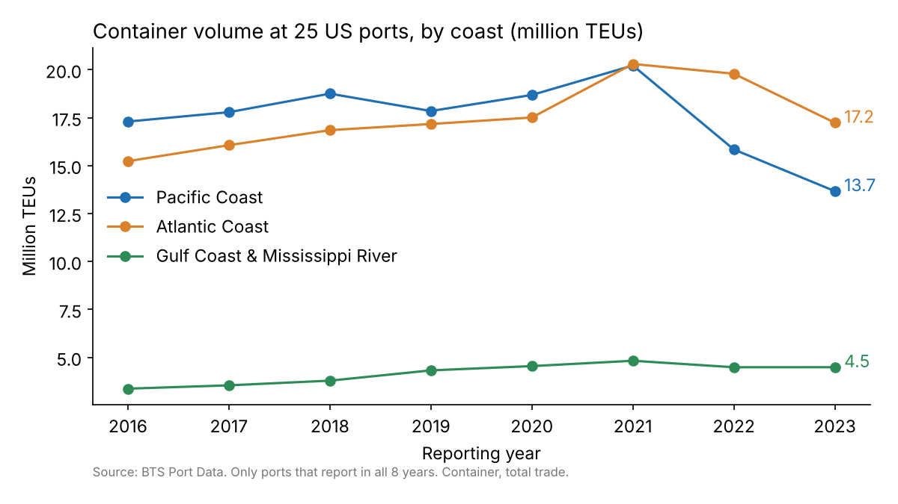

# Should a freight broker shift container capacity away from West Coast ports?

## Who decides what
A freight broker's capacity planner decides which port regions to book container trucking and warehouse capacity in for next year.

## Data
- Publisher: US Department of Transportation, Bureau of Transportation Statistics (BTS)
- Link: https://data.bts.gov/d/5rpz-kgm9
- Date accessed: 2026-11-19 (file downloaded)
- License or terms: Public domain (US government data)
- Repo rule: LINK ONLY

## What one row means
One row is one port, one year and one kind of cargo flow. A TEU is a twenty-foot equivalent unit, a standard container size.

## What I did in my tool (Excel or Tableau)
- Tool: Python (pandas), run by Claude. I used Tableau for the border chart.
- Columns I kept: port_name, region, reporting_year, cargo_type, units, trade_type, volume
- Filters: cargo_type is CONTAINER; units is Container TEUs; trade_type is TOTAL; only ports with data in each of the 8 years (2016 to 2023), which leaves 25 ports
- Pivot: rows region, columns reporting year, values sum of volume in millions of TEUs. Percent change is its own column.
- Rows after my filters: 200 (25 ports, 8 years each). The downloaded file has 8,386 rows before filters.
- Check pivot: I expected 200 rows (25 ports times 8 years) and found 200.
- Pivot file: analysis/port-containers-pivot.csv (https://github.com/sonysimonbusiness-maker/gmba634-term-project/blob/main/analysis/port-containers-pivot.csv)

## What the numbers show
```
region,teu_millions_2016,teu_millions_2017,teu_millions_2018,teu_millions_2019,teu_millions_2020,teu_millions_2021,teu_millions_2022,teu_millions_2023,change_2021_to_2023_pct
Atlantic Coast,15.23,16.06,16.85,17.17,17.51,20.3,19.79,17.23,-15.1
Gulf Coast and Mississippi River,3.37,3.54,3.78,4.32,4.54,4.82,4.48,4.49,-7.0
Pacific Coast,17.3,17.78,18.75,17.84,18.68,20.22,15.84,13.67,-32.4
```


## My finding
Container volume at Pacific Coast ports fell 32.4% from 2021 to 2023, from 20.22 million to 13.67 million TEUs.

## What this data cannot show
It counts containers, not what is inside them or what they are worth, so it cannot tell the planner which lanes pay more.

## What I checked
Claude recomputed the percent change from the pivot values with a script and it matched. I have not yet compared the pivot with the BTS site myself.

## Number trail
See analysis/number-trail.md (https://github.com/sonysimonbusiness-maker/gmba634-term-project/blob/main/analysis/number-trail.md)
